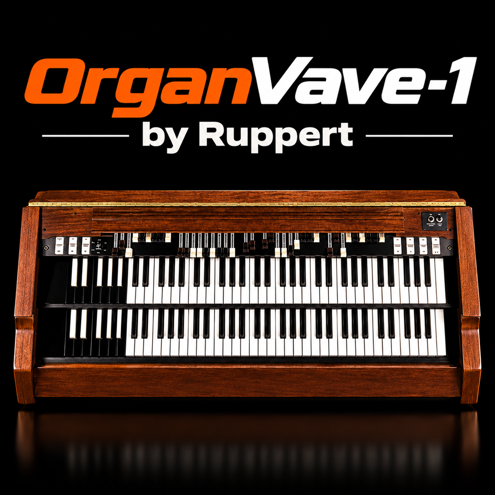

# OrganVave-1

A tonewheel-organ firmware for the M-VAVE FM-1, by Guilherme Ruppert: an organ in the style of the classic electromechanical
consoles (nine drawbars, percussion, scanner vibrato / chorus, a valve-style preamp) with a rotary speaker, ported from
[setBfree](https://github.com/pantherb/setBfree) to integer C for the FM-1's chip.

**Status: v0.1.0, the first organ.** The firmware now plays one instrument: the upper manual's nine drawbars on setBfree's
tone generator (the tonewheels, the key click, the crosstalk and the temperaments), with eight factory patches and the
drawbar page. Percussion, vibrato, the rotary, the lower manual and the pedals come in the milestones below. Nothing here
has been tested on a real FM-1 yet. Do not install it unless you know how to recover an FM-1 (see [BUILDING.md](BUILDING.md)).

## Plan

[ORGAN.md](ORGAN.md) is the approved plan: the map from setBfree to the firmware, the measured budget, the two rotary
models (CLASSIC: setBfree's `whirl.c`, reduced; LIGHT: a minimal physical model; chosen per preset), the interface (drawn
after the real console's panel), the presets, the tests and the milestones:

| version | contents |
| --- | --- |
| 0.0.x | the house: identity, names, docs; the slimming |
| 0.1.0 | tone generator, upper manual, click, the drawbar page, 8 presets (now) |
| 0.2.0 | percussion, vibrato / chorus |
| 0.3.0 | rotary (CLASSIC and LIGHT), drive, the effects section |
| 0.4.0 | lower manual and pedals over MIDI, swell, MIDI CC, the full bank |
| 0.5.0 | editor, site, installer, emulator |
| 1.0.0 | after it has been tested on the hardware |

## Building and developing

[BUILDING.md](BUILDING.md) sets up the toolchain and builds the package; [DEVELOPING.md](DEVELOPING.md) explains the
architecture, the method and the tests; [CLAUDE.md](CLAUDE.md) is the short list of rules.

## Origin and licence

OrganVave-1 is a fork of FMini-1 (Guilherme Ruppert), itself a fork of [Felucca](https://github.com/hugelton/Felucca) by
Leo Kuroshita (Hügelton Instruments). It is free software under the GNU General Public License version 3 only
([LICENSE](LICENSE)); the parts with other licences are listed in [LICENSING.md](LICENSING.md) and credited in
[CREDITS.md](CREDITS.md).

"M-VAVE" and "FM-1" are trademarks of their owners. OrganVave-1 is independent firmware, not affiliated with or endorsed by
them, and uses no other trademarks in its names.
